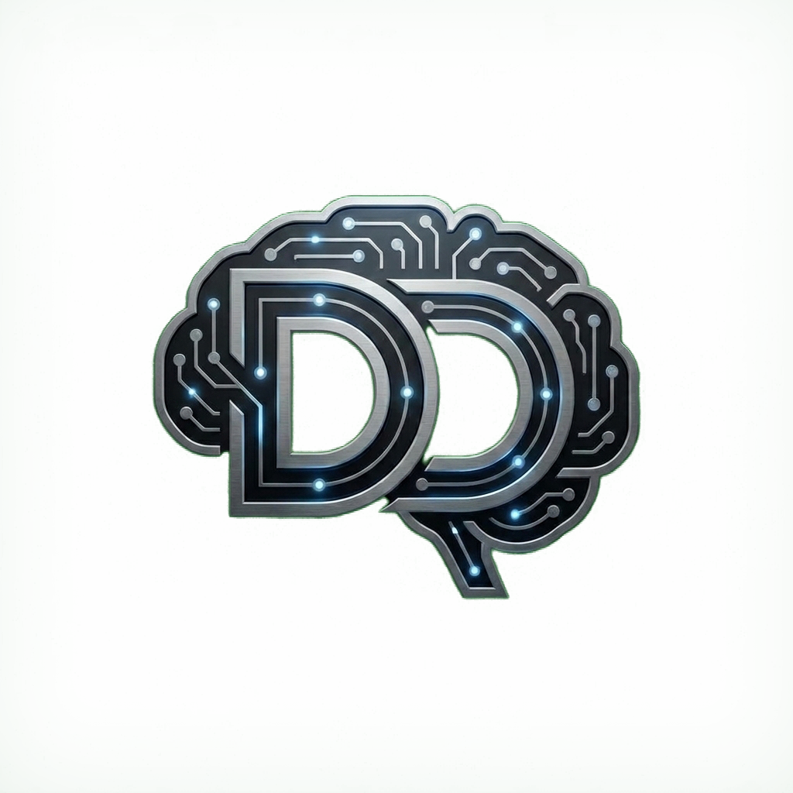

# Sansürsüz Lokal AI Stüdyosu - DD:YZ

<p align="center">
  
</p>

<p align="center">
  <strong>Windows, Linux ve macOS için taşınabilir (portable), yerel çalışan yapay zeka stüdyosu: Stable Diffusion (Görsel Üretimi), LLM'ler (Yapay Zeka Sohbeti), Whisper / Duyu / Seda (Sesten Metne), Türkçe TTS (Antalia, Ahenk, EMA, Supertonic, OmniVoice), Müzik / Ses Efekti (Stable Audio 3, MusicGen, AudioLDM) ve Video (AnimateDiff, Wan 2.1, SVD). NVIDIA/AMD/Intel GPU ve Apple Silicon hızlandırmasıyla çalışır.</strong>
</p>

<p align="center">
  
  
  
</p>

<p align="center">
  <a href="https://youtu.be/jqFI4pxobBY">
    
  </a>
</p>

<p align="center">
  <a href="https://youtu.be/jqFI4pxobBY">📺 Uygulamanın tanıtımını ve kurulumunu adım adım anlatan videoyu izleyin (DD:YZ Kanalı)</a>
</p>

---

## 📑 İçindekiler

* [Sansürsüz Lokal AI Stüdyosu Nedir?](#nedir)
* [Öne Çıkan Özellikler](#ozellikler)
* [Çalışma Alanı ve Motor Mimarisi](#mimari)
* [Desteklenen Modeller](#modeller)
* [Klasör Yapısı](#yapi)
* [Başlarken (Kurulum ve Çalıştırma)](#baslarken)
  * [Windows Kurulumu](#windows-kurulumu)
  * [Linux Kurulumu](#linux-kurulumu)
  * [macOS Kurulumu](#macos-kurulumu)
* [Donanım Uyumluluğu ve Hızlandırma](#donanim)
* [Sorun Giderme ve Sıkça Sorulan Sorular (SSS)](#sss)
* [Kaynaktan Derleme (Geliştiriciler İçin)](#derleme)
* [Lisans](#lisans)
* [İletişim ve Topluluk](#iletisim)

---

## <a id="nedir"></a> 💡 Sansürsüz Lokal AI Stüdyosu Nedir?

**Sansürsüz Lokal AI Stüdyosu - DD:YZ**, Windows, Linux ve macOS işletim sistemleri için tamamen çevrimdışı, taşınabilir ve kendi kendine yeten (*self-contained*) hepsi-bir-arada yerel yapay zeka merkezidir. Bulut tabanlı sistemlerin aksine; sansür, içerik filtreleme, veri takibi, abonelik ücreti veya giriş zorunluluğu olmadan tamamen kendi bilgisayarınızın donanımı üzerinde çalışır.

Aşağıdaki yerel yapay zeka kabiliyetlerini tek bir kullanıcı dostu arayüzde birleştirir:

1. 🎨 **Görsel Üretimi (Stable Diffusion):** SD 1.5 ve SDXL `.safetensors` / `.ckpt` modelleriyle metinden görsel ve görselden görsel (img2img) üretimi.
2. 💬 **Metin Sohbeti (LLM'ler):** `llama.cpp` altyapısıyla GGUF formatındaki açık dil modelleriyle gizli sohbet (isteğe bağlı web araması ve bulut modelleri dahil).
3. 🎙️ **Sesten Metne (Whisper / Duyu / Seda):** `whisper.cpp`, Türkçe için optimize Duyu-small ve noktalamayı kendisi yapan Seda-v0.2 ile ses/video dosyalarını ve mikrofon kaydını yazıya dökme; Harfiyen Türkçe noktalama, SRT/VTT altyazı ve karaokeli altyazılı video dışa aktarma.
4. 🔊 **Metinden Sese (Türkçe TTS):** Antalia-2 Mini (erkek), Ahenk Cep (kadın, 7 üslup), EMA Lightning, Supertonic-3 (10 ses) ve OmniVoice (sıfır-örnek ses klonlama). Kokoro yalnızca İngilizce seslere sahiptir.
5. 🎵 **Müzik ve Ses Efekti:** Stable Audio 3 (Small Music / Medium, 44.1 kHz stereo) ve MusicGen (Small / Medium / Large) ile müzik; Stable Audio 3 Small SFX ve AudioLDM / AudioLDM 2 ile ses efekti.
6. 🎬 **Video:** AnimateDiff ve Wan 2.1 T2V 1.3B ile metinden video, Stable Video Diffusion XT 1.1 ile görselden video.

---

## <a id="ozellikler"></a> ✨ Öne Çıkan Özellikler

* 🔒 **Yerel ve Gizli:** Yerel modellerle yapılan tüm çıkarımlar (inference) kendi donanımınızda gerçekleşir. Bulut modelleri (OpenRouter, OpenAI, Gemini, Anthropic, ElevenLabs, MiniMax) yalnızca siz API anahtarı girip seçtiğinizde kullanılır; bu isteklerde içerik ilgili servise gönderilir ve ücretlendirilebilir.
* 📦 **Taşınabilir Kurulum (Windows):** Node.js, görsel / metin / ses tanıma motorları ve Türkçe TTS, Duyu / Seda, müzik ve video için gereken özel Python ortamı (Python 3.12 + PyTorch + paketler) ilk çalıştırmada proje klasörüne (`app/tools/`) kurulur; sisteminize global olarak hiçbir şey yüklenmez. NVIDIA kartlarda sürücüye uygun CUDA'lı PyTorch, diğer sistemlerde CPU sürümü seçilir.
* ⚡ **Otomatik Donanım Hızlandırma:** Sistem özelliklerinizi otomatik algılayarak NVIDIA (CUDA), AMD (ROCm / Vulkan), Intel (Vulkan / OpenVINO NPU) veya Apple Silicon (Metal) hızlandırmasını devreye alır.
* 📥 **Entegre Model Yöneticisi:** Hugging Face üzerindeki açık modelleri tek tıkla doğrudan uygulama içinden indirin ve yönetin.
* 📊 **Canlı Performans Monitörü:** CPU, RAM, GPU ve VRAM kullanımını web arayüzünde canlı olarak izleyin.
* 🖼️ **Yerel Çıktı Galerisi:** Üretilen tüm görselleri, prompt (istem) parametrelerini ve JSON meta verilerini otomatik olarak düzenli bir galeride saklar.

---

## <a id="mimari"></a> 🏗️ Çalışma Alanı ve Motor Mimarisi

Sistem RAM'ini veya ekran kartı belleğini (VRAM) gereksiz yere tüketmemek için metin ve görsel motorları varsayılan olarak birbirini dışlayacak şekilde çalışır. Arayüz içinden çalışma alanları arasında tek tıkla geçiş yapabilirsiniz:

* **Görsel Üretimi Çalışma Alanı:** Optimize edilmiş `stable-diffusion.cpp` motorunu kullanır. İndirilen görsel modelleri `app/models/` klasöründe saklanır.
* **Metin Sohbeti Çalışma Alanı:** Taşınabilir `llama.cpp` sunucu motorunu kullanır. Dil modelleri (`.gguf`) `app/llm-models/` klasöründe saklanır.
* **Konuşma Tanıma (Whisper / Duyu / Seda):** Whisper modelleri `whisper.cpp` ile, Duyu ve Seda Python worker'larıyla (`scripts/workers/speech-*.py`) çalışır (`app/speech-models/`).
* **Metinden Sese (TTS):** Türkçe motorlar Python worker'ları (`scripts/workers/tts-*.py`), Kokoro ise `kokoro-js` ile çalışır (`app/tts-models/`).
* **Müzik / Ses Efekti ve Video:** PyTorch + diffusers / transformers worker'ları (`scripts/workers/music-worker.py`, `stable-audio-worker.py`, `video-generator-worker.py`); modeller `app/music-models/` ve `app/video-models/` klasörlerindedir.

---

## <a id="modeller"></a> 🧠 Desteklenen Modeller

Uygulama, entegre motorlar tarafından doğrudan yüklenebilen tek dosyalık yerel modeller için optimize edilmiştir.

### Görsel Üretimi Modelleri

| Model Tipi | Destek Durumu | Dosya Konumu | Notlar |
| :--- | :--- | :--- | :--- |
| **Stable Diffusion 1.5 Checkpoint** | ✅ Tam Destek | `app/models/` | En yüksek hız ve uyumluluk. `.safetensors` veya `.ckpt` dosyaları kullanılır. |
| **SDXL Checkpoint** | ✅ Tam Destek | `app/models/` | Yüksek çözünürlük ve kalite. SD 1.5'e göre daha fazla VRAM gerektirir. |
| **Tek Dosyalı SD/SDXL GGUF** | ⚠️ Sınırlı | `app/models/` | Yalnızca bağımsız tek dosya halinde paketlenmiş GGUF checkpoint'ler desteklenir. |
| **OpenVINO Görsel Modelleri** | ⚡ Intel NPU | `app/openvino-models/` | Intel Core Ultra NPU kurulumundan sonra Model Yöneticisi'nden indirilebilir. |
| **CoreML Görsel Modelleri** | 🍎 Apple Silicon | `app/models/` | macOS üzerinde Apple Silicon ve CoreML optimizasyonuyla çalışır. |
| **Çok Dosyalı Flux, Hunyuan, Wan, Z-Image** | ❌ Desteklenmiyor | - | Ayrı difüzyon, VAE ve text-encoder dosyaları gerektiren karmaşık iş akışları doğrudan tek tıkla yüklenemez. |
| **LoRA / ControlNet / Tek Başına VAE** | ❌ Desteklenmiyor | - | Yardımcı bileşenler bağımsız model olarak başlatılamaz. |

#### Model Yöneticisi'nden Önerilen Bazı Görsel Modeller:

| Model Adı | Dosya Adı | Mimari | Boyut | Önerilen Kullanım Alanı |
| :--- | :--- | :--- | :--- | :--- |
| **Juggernaut XL v9 Lightning** | `Juggernaut_RunDiffusionPhoto2_Lightning_4Steps.safetensors` | SDXL | 7.1 GB | Fotogerçekçi portre ve manzara (4-6 adım, CFG 1.5, Euler + SGM Uniform). |
| **DreamShaper XL Lightning** | `DreamShaperXL_Lightning.safetensors` | SDXL | 6.9 GB | İllüstrasyon, dijital sanat, fantezi ve 3D render tarzı (4-6 adım, Euler + SGM Uniform). |
| **RealVisXL V5.0 (fp16)** | `RealVisXL_V5.0_fp16.safetensors` | SDXL | 6.9 GB | Fotogerçekçi portre ve sahne (30 adım, CFG 4-6, DPM++ 2M + Karras). |
| **Realistic Vision V5.1** | `Realistic_Vision_V5.1_fp16-no-ema.safetensors` | SD 1.5 | 2.1 GB | Fotogerçekçi SD 1.5; AnimateDiff videoları da bu modeli temel alır. |
| **DreamShaper 8** | `DreamShaper_8_pruned.safetensors` | SD 1.5 | 2.1 GB | Hızlı, düşük bellek ve orta/giriş seviye GPU'lar için genel amaçlı üretim. |
| **CyberRealistic V8** | `CyberRealistic_V8_FP16.safetensors` | SD 1.5 | 2.1 GB | Gerçekçi insan ve çevre detayları için hafif SD 1.5 modeli. |
| **Rev Animated v1.2.2** | `rev-animated-v1-2-2.safetensors` | SD 1.5 | 5.5 GB | Anime, stilize çizim ve 2.5D tarz (dosya fp32 olduğu için büyüktür). |
| **Stable Diffusion 1.5** | `v1-5-pruned-emaonly.safetensors` | SD 1.5 | 4.3 GB | Orijinal SD 1.5 temel modeli. |

---

### Metin, Konuşma ve Seslendirme Modelleri

| Çalışma Alanı | Desteklenen Formatlar | Dosya Konumu | Notlar |
| :--- | :--- | :--- | :--- |
| **Metin Sohbeti (LLM)** | `.gguf` (llama.cpp) | `app/llm-models/` | Qwen 2.5, Llama 3, Mistral, Gemma vb. GGUF formatındaki tüm açık dil modelleri. Görsel anlama (Vision) için uyumlu `mmproj` dosyası da eklenebilir. |
| **Sesten Metne (STT)** | whisper.cpp `.bin`, Duyu ONNX, Seda (sherpa-onnx) | `app/speech-models/` | Whisper (tiny, base, small, large-v3-turbo); Türkçe için Duyu-small (Kaan Aydınlı, FLEURS-tr %7.87 WER) ve Seda-v0.2 (Ahmet Atasoğlu, FLEURS-tr %6.38 WER; noktalama, büyük harf ve rakamları kendisi yazar, CC BY-SA 4.0). |
| **Metinden Sese (TTS)** | Model klasörleri / `.json` tanımları | `app/tts-models/` | Türkçe: Antalia-2 Mini, Ahenk Cep, EMA Lightning, Supertonic-3, OmniVoice. Kokoro yalnızca İngilizce. XTTS, Chatterbox, CosyVoice ve Piper bu sürümde entegre değildir. |
| **Müzik / Ses Efekti** | Stable Audio 3 / Diffusers / AudioCraft klasörleri | `app/music-models/` | Stable Audio 3 Small Music, Small SFX (en fazla 120 sn) ve Medium (NVIDIA GPU, en fazla 300 sn), 44.1 kHz stereo; Hugging Face lisans onayı + HF Token gerekir (Stability AI Community License). MusicGen Small/Medium/Large (32 kHz), AudioLDM-S, AudioLDM 2, AudioLDM 2 Large (16 kHz). |
| **Video** | Diffusers klasörleri / `.ckpt` | `app/video-models/` | AnimateDiff v1.5 v2, Wan 2.1 T2V 1.3B (480p), SVD-XT 1.1 (görselden video). LTX-Video entegre değildir. Bulutta MiniMax Hailuo 02 / 2.3. |

---

## <a id="yapi"></a> 📁 Klasör Yapısı

```text
SansursuzLokalAIStudyosu-V2/
├── windows.bat                # Windows Başlatıcı (Çift tıklayarak açın)
├── linux.sh                   # Linux Başlatıcı (Terminal üzerinden çalıştırın)
├── mac.sh                     # macOS Başlatıcı (Terminal üzerinden çalıştırın)
├── LICENSE                    # MIT Açık Kaynak Lisansı
├── README.md                  # Ayrıntılı Türkçe sistem dokümantasyonu
├── scripts/
│   ├── setup/                 # Platforma özel otomatik kurulum betikleri
│   ├── reset/                 # Temiz kurulum ve ortam sıfırlama araçları
│   ├── server/                # Node.js yerel web sunucusu ve süreç yöneticisi
│   ├── workers/               # Python / Node TTS, ses tanıma, müzik ve video işçileri
│   └── build/                 # İsteğe bağlı kaynaktan derleme yardımcıları
└── app/
    ├── frontend/              # Web arayüzü kaynak kodları (React + Vite)
    ├── models/                # Görsel modelleri (.safetensors, .ckpt)
    ├── llm-models/            # Dil modelleri (.gguf)
    ├── speech-models/         # Whisper (.bin), Duyu ve Seda ses tanıma modelleri
    ├── tts-models/            # Seslendirme (TTS) modelleri
    ├── music-models/          # Stable Audio 3 / MusicGen / AudioLDM modelleri
    ├── video-models/          # AnimateDiff / Wan 2.1 / SVD modelleri
    ├── reference-voices/      # Ses klonlama referans kayıtları
    └── outputs/               # Üretilen görseller ve parametre kayıtları
```

---

## <a id="baslarken"></a> 🚀 Başlarken (Kurulum ve Çalıştırma)

> 📺 **Videolu Anlatım:** Kurulumu ve kullanımı adım adım görmek için [tanıtım ve kurulum videosunu](https://youtu.be/jqFI4pxobBY) izleyebilirsiniz.

Bilgisayarınızda modern bir internet tarayıcısının (Chrome, Edge, Brave, Firefox vb.) kurulu olduğundan emin olun. İşletim sisteminize uygun adımları takip edin:

### 🪟 Windows Kurulumu

1. **Başlatın:** `windows.bat` dosyasına çift tıklayın.
   > *İlk çalıştırmada betik, taşınabilir Node.js ortamını, sisteminize uygun GPU/CPU motorlarını ve Türkçe ses / müzik / video için Python bileşenlerini otomatik olarak indirip yapılandırır. Toplam indirme yaklaşık 7-9 GB'tır (modeller hariç) ve bağlantı hızınıza göre uzun sürebilir.*
2. **Model Ekleyin:** İndirdiğiniz modelleri ilgili klasörlere bırakın veya doğrudan arayüzdeki **Model Yöneticisi** sekmesinden tek tıkla indirin.
3. **Kullanmaya Başlayın:** Tarayıcınızda otomatik olarak `http://localhost:1420` adresi açılacaktır.

---

### 🐧 Linux Kurulumu

#### 1. Standart Terminal Kurulumu ve Başlatma
Ubuntu, Debian, Fedora, Arch, Linux Mint gibi dağıtımlarda terminalden kurulum yapmak için:

1. **Depoyu İndirin (Clone):**
   ```bash
   git clone https://github.com/DDYapayZeka/SansursuzLokalAIStudyosu-V2.git
   cd SansursuzLokalAIStudyosu-V2
   ```

2. **Çalıştırma İzni Verin:**
   ```bash
   chmod +x linux.sh scripts/setup/*.sh
   ```

3. **Uygulamayı Başlatın:**
   ```bash
   ./linux.sh
   ```
   > [!NOTE]
   > **İlk Çalıştırma:** Betik, taşınabilir Linux Node.js ortamını ve GPU/CPU motorlarını `app/` klasörü altına otomatik kurar ve tarayıcınızı açar.
   > - **NVIDIA Kullanıcıları:** CUDA hızlandırması otomatik algılanır veya kurulur.
   > - **AMD Radeon GPU:** ROCm desteği eklemek için `./linux.sh --max-perf` ile çalıştırabilirsiniz.
   > - **Intel Core Ultra NPU:** OpenVINO NPU desteği için `./linux.sh --setup-openvino` kullanabilirsiniz.

4. **Model Yükleyin:** Arayüzdeki **Model Yöneticisi** sekmesinden tek tıkla model indirebilir veya kendi modellerinizi `app/models/` ya da `app/llm-models/` klasörlerine taşıyabilirsiniz.

#### 2. USB Belleğe / Harici Diske Kurulum (Taşınabilir Kullanım)
Projemiz **%100 bağımsız (self-contained)** mimaridedir; işletim sisteminize global hiçbir paket yüklemez. Tüm motorlar, ayarlar ve indirilen modeller projenin kendi klasörü (`app/`) içinde saklanır. Bu sayede stüdyoyu doğrudan bir USB bellek veya harici SSD üzerinden tak-çalıştır şeklinde kullanabilirsiniz.

* **⚠️ USB Dosya Sistemi Formatı (Önemli):**
  * **FAT32 Kullanmayın:** FAT32 formatı tek parça **4 GB'tan büyük** dosyaları desteklemez. Yapay zeka modelleri genellikle 4-8 GB+ boyutunda olduğu için indirme yarım kalır.
  * **Önerilen Formatlar:** Hem Windows hem Linux'ta ortak kullanmak için **exFAT** veya **NTFS**, yalnızca Linux'ta kullanacaksanız **ext4** formatı önerilir (USB 3.0+ veya harici SSD tavsiye edilir).

* **USB Üzerinden Adım Adım Çalıştırma:**
  1. USB belleğinizi takın ve terminalden USB dizinine geçin:
     ```bash
     cd /media/$USER/USB_DISKINIZIN_ADI/
     ```
  2. Projeyi doğrudan USB içine klonlayın:
     ```bash
     git clone https://github.com/DDYapayZeka/SansursuzLokalAIStudyosu-V2.git
     cd SansursuzLokalAIStudyosu-V2
     ```
  3. Başlatın:
     ```bash
     bash linux.sh
     ```
     > [!TIP]
     > **İzin Hatası Alırsanız:** Bazı Linux dağıtımları harici USB diskleri güvenlik amacıyla `noexec` (çalıştırma kısıtlaması) bayrağıyla bağlar. Eğer `./linux.sh` izni reddedilirse, doğrudan `bash linux.sh` komutu ile başlatabilirsiniz.

---

### 🍏 macOS Kurulumu

1. **Çalıştırma İzni Verin:** Terminali açın ve proje klasöründe betiğe yetki verin:
   ```bash
   chmod +x mac.sh
   ```
2. **Başlatın:**
   ```bash
   ./mac.sh
   ```
   > Önceden derlenmiş macOS motoru **Apple Silicon (M1, M2, M3, M4 veya daha yeni)** işlemciler için optimize edilmiştir ve **Metal** GPU hızlandırmasını kullanır.
3. **Kullanmaya Başlayın:** Tarayıcınızda `http://localhost:1420` adresini açın.

---

## <a id="donanim"></a> 🖥️ Donanım Uyumluluğu ve Hızlandırma

### Windows Donanım Desteği

| Ekran Kartı / Donanım | Kullanılan Teknoloji | Hızlandırma Durumu | Notlar |
| :--- | :--- | :--- | :--- |
| **NVIDIA RTX / GTX** | CUDA | 🟢 Yerel Donanım | CUDA 12 optimizasyonları ile en yüksek performans (`sd-cuda.exe`). |
| **AMD Radeon** | Vulkan | 🟢 Yerel Donanım | Vulkan API hızlandırması ile yüksek performans (`sd-vulkan.exe`). |
| **Intel Arc / Iris Xe** | Vulkan | 🟢 Yerel Donanım | Intel GPU'lar için Vulkan hızlandırması kullanılır. |
| **Dahili Grafik / Sadece CPU** | CPU | 🟡 İşlemci Modu | Donanım hızlandırma olmadan CPU çekirdekleri üzerinde çalışır (daha yavaş). |

### Linux Donanım Desteği

| Ekran Kartı / Donanım | Birincil Motor | Yedek Motor | Notlar |
| :--- | :--- | :--- | :--- |
| **NVIDIA** | CUDA / Vulkan | Vulkan / CPU | NVIDIA kartları otomatik algılanır. CUDA hazır ikiliyi kurar veya kaynaktan derler. |
| **AMD Radeon** | ROCm | Vulkan | ROCm sürücüleri kuruluysa en yüksek AMD performansını sunar. |
| **Intel Arc / Entegre** | Vulkan | CPU | Çoklu üretici Vulkan API desteği. |
| **Intel Core Ultra NPU** | OpenVINO NPU | CPU | Intel Linux NPU sürücüsü, kernel 6.6+ ve `./linux.sh --setup-openvino` gerektirir. |
| **Sadece CPU** | CPU | - | Tüm sistemlerde işlemci üzerinde çalışır. |

### macOS Donanım Desteği

| Donanım Mimarisi | Birincil Hızlandırma | Notlar |
| :--- | :--- | :--- |
| **Apple Silicon (M1 - M4)** | Metal GPU / Neural Engine | Resmi ARM64 motoru ile mükemmel bellek ve GPU verimliliği. |

---

## <a id="sss"></a> ❓ Sorun Giderme ve Sıkça Sorulan Sorular

* **Ortamı Sıfırlama ve Onarma:**  
  Herhangi bir bileşen eksik inerse veya ortamı temizlemek isterseniz `scripts/reset/reset.ps1` (Windows) veya `scripts/reset/reset.sh` (Linux/macOS) çalıştırabilirsiniz. Bu işlem modellerinizi veya çıktı görsellerinizi **silmez**, sadece motorları ve önbelleği yeniler.

* **Linux `GLIBC_2.38 not found` Hatası:**  
  Önceden derlenmiş Linux motorları modern `glibc 2.38+` kütüphanelerini (Ubuntu 24.04, Fedora 40+, Mint 22 vb.) gerektirir. Daha eski bir dağıtım kullanıyorsanız işletim sisteminizi güncelleyebilir veya motorları kaynaktan derleyebilirsiniz.

* **Port Çakışması (Port Meşgul Uyarısı):**  
  Web arayüzü varsayılan olarak `1420` portunda çalışır. Eğer bu port doluysa sistem otomatik olarak bir sonraki boş portu bularak arayüzü başlatır.

* **Çift GPU / Dahili Ekran Kartı Seçimi:**  
  Vulkan motoru, `vulkaninfo` ile harici (discrete) ekran kartını Windows ve Linux'ta otomatik seçer (örn. AMD Ryzen dahili grafik + NVIDIA kart). Elle zorlamak için: `SD_VULKAN_DEVICE=vulkan1 ./linux.sh` (Windows'ta `set SD_VULKAN_DEVICE=vulkan1`).

* **Türkçe TTS / Müzik / Video "Python paketleri bulunamadı" Hatası:**  
  Bu özellikler ilk kurulumda `app/tools/python-env` içine kurulan özel Python ortamını kullanır. Kurulum yarıda kaldıysa veya başarısız olduysa uygulamayı kapatıp `scripts\setup\setup-python.ps1` betiğini sağ tık > "PowerShell ile Çalıştır" ile yeniden çalıştırın. Bir güncelleme yeni paketler eklediğinde `windows.bat` eksikleri bir sonraki açılışta kendisi tamamlar. Linux / macOS'ta uygulama conda / sistem Python ortamlarını tarar ve gerekli paketleri içe aktarabilen ortamı seçer; paketleri kendiniz kurmak için PyTorch'tan sonra `pip install -r scripts/setup/requirements-ai.txt` ve ardından `pip install --no-deps -r scripts/setup/requirements-ai-nodeps.txt` çalıştırın. Belirli bir ortam kullanmak için `app/config/python-paths.json` dosyasına örneğin `{"video": "C:\\yol\\python.exe", "tts-omnivoice": "C:\\yol\\python.exe"}` yazın.

* **Stable Audio 3 İndirmesi "gated" / 401 Hatası Veriyor:**  
  Stable Audio 3 modelleri Hugging Face'te lisans onayı ister. Model sayfasında (örn. `huggingface.co/stabilityai/stable-audio-3-small-music`) giriş yapıp lisansı kabul edin, ardından Model Merkezi > **HF Token Ekle** ile "Read" yetkili token'ınızı kaydedip indirmeyi yeniden başlatın. Small Music, Small SFX ve Medium için onay ayrı ayrı verilir.

* **Başka Bir Cihazdan (Ağ Üzerinden) Erişim:**  
  Güvenlik için sunucu yalnızca `127.0.0.1` üzerinde dinler ve yabancı `Host` başlıklarını reddeder. Yerel ağdan erişmek için `LISTEN_HOST=0.0.0.0` ve `ALLOWED_HOSTS=192.168.1.20` (bilgisayarınızın IP'si) ortam değişkenleriyle başlatın.

* **Windows `0xC0000135` (Eksik DLL) Hatası:**  
  Sisteminizde gerekli ekran kartı sürücüsünün veya Vulkan/CUDA çalışma zamanının eksik olduğunu gösterir. Grafik sürücünüzü (NVIDIA Game Ready / AMD Adrenalin) güncelleyin.

---

## <a id="derleme"></a> 🛠️ Kaynaktan Derleme (İleri Düzey)

Eski bir Linux dağıtımında veya özel bir donanım üzerinde çalışıyorsanız, arka uç motorlarını kendi sisteminizde sıfırdan derleyebilirsiniz:

### Gereksinimler
* `git`, `cmake`, `make` (veya `ninja`) ve modern bir C++17 derleyici (`g++` / `clang++`).
* **CUDA İçin:** NVIDIA CUDA Toolkit (`nvcc`).
* **Vulkan İçin:** Vulkan SDK ve `glslc` paketi.

### Derleme Adımları:
```bash
# 1. Kaynak depoyu klonlayın
git clone https://github.com/leejet/stable-diffusion.cpp.git
cd stable-diffusion.cpp
mkdir build && cd build

# 2. Donanımınıza uygun şekilde yapılandırın (Birini seçin):
# CUDA (NVIDIA):
cmake .. -DSD_CUDA=ON -DSD_BUILD_SHARED_LIBS=ON -DCMAKE_BUILD_TYPE=Release

# Vulkan (AMD / Intel):
cmake .. -DSD_VULKAN=ON -DSD_BUILD_SHARED_LIBS=ON -DCMAKE_BUILD_TYPE=Release

# macOS Metal:
cmake .. -DSD_METAL=ON -DSD_BUILD_SHARED_LIBS=ON -DCMAKE_BUILD_TYPE=Release

# 3. Derlemeyi başlatın
cmake --build . --config Release -j$(nproc 2>/dev/null || sysctl -n hw.ncpu)

# 4. Çıkan ikilileri projenin ilgili klasörüne kopyalayın
cp bin/sd* /yol/SansursuzLokalAIStudyosu-V2/app/backend/linux/vulkan/sd-vulkan
```

---

## <a id="lisans"></a> 📜 Lisans

Bu proje **[MIT Lisansı](LICENSE)** ile lisanslanmıştır. Projede kullanılan `stable-diffusion.cpp` ve `llama.cpp` projeleri kendi açık kaynak lisanslarına (MIT) sahiptir. İndirdiğiniz yapay zeka modelleri ise ilgili modellerin kendi açık kaynak kullanım koşullarına tabidir.

---

## <a id="iletisim"></a> 📢 İletişim ve Topluluk

* 🎬 **Tanıtım ve Kurulum Videosu:** [youtu.be/jqFI4pxobBY](https://youtu.be/jqFI4pxobBY)
* 📺 **YouTube Kanalımız:** [Derine Dalıyoruz: Yapay Zeka (DD:YZ)](https://www.youtube.com/@derinedaliyoruzyapayzeka)
* 📧 **E-posta İletişim:** [divingdeep.ai.tr@gmail.com](mailto:divingdeep.ai.tr@gmail.com)

Projeyi beğendiyseniz GitHub üzerinde **⭐ Yıldız (Star)** vererek ve YouTube kanalımıza abone olarak destek olabilirsiniz!
